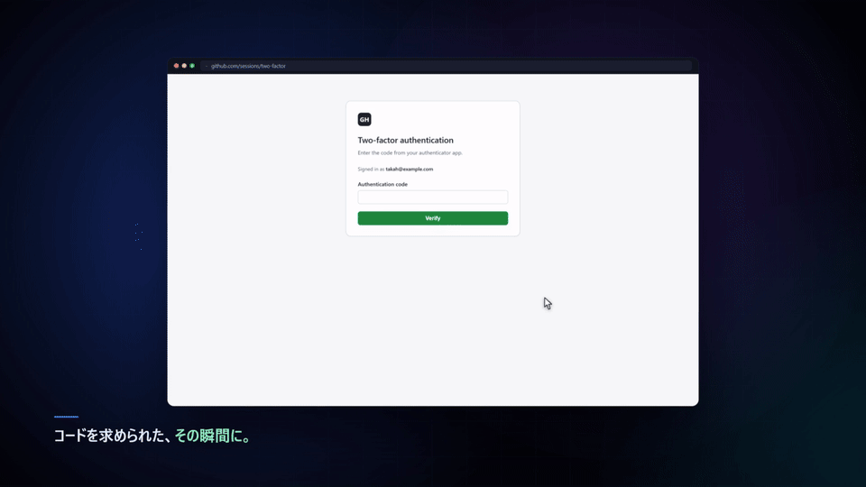

# TOTP Runner

**Your 2FA codes, right in the field.**

A Chrome extension that detects TOTP inputs and suggests or fills in the right code from the accounts you've registered — only when a code field gets focus. No persistent UI.

[日本語の README](README.md)

---

▶ **[Full demo video (MP4, 35s)](docs/demo.mp4)**

## What it changes

**Focus the field and the suggestions appear.**
No more switching to an authenticator app, hunting for the code, and coming back. TOTP fields are recognised from `autocomplete="one-time-code"`, label text, input length, and surrounding copy. One-digit-per-box inputs work too.

**You stop picking the wrong account.**
When a site has several accounts, the one you're actually signing in as is ranked first, based on the username and your history on that site.

**One click fills the code.**
Click a suggestion or press `Enter`. It never submits the form for you.

---

## Install

Takes about a minute. No programming knowledge needed.

### 1. Download

Open [Releases](../../releases) and download the latest **`totp-runner-x.y.z.zip`**, then unzip it.
You'll get a folder containing `manifest.json`.

### 2. Load it into Chrome

1. Open `chrome://extensions/`
2. Turn on **Developer mode** (top right)
3. Click **Load unpacked** (top left)
4. Select the folder from step 1

### 3. Pin it

Click the puzzle-piece icon in the toolbar and pin **TOTP Runner**.

> Not on the Chrome Web Store. You load it locally, so updates mean downloading a new ZIP and pressing Reload.

---

## Usage

### Register an account

Click the toolbar icon, then **＋ Add**.

| Field | What goes in |
|---|---|
| Type | Usually TOTP. For Steam codes, Steam Guard |
| Label | The name shown in the list |
| Username / email | The login ID for that service — important if you use several accounts |
| Secret | The Base32 key from the service's setup screen |
| Site | The domain the code belongs to (e.g. `github.com`) |

**＋ Add current tab's site** fills the domain for you.

To import in bulk, use **Import** — from a QR code or an `otpauth://` URI.

### Use it on a site

Click the TOTP field. Suggestions appear. Click one, or press `Enter`.

The first time you use a site it says "this site isn't registered" — add it from the popup.
**On sites you haven't registered, no account names and no codes are ever shown.**

### Shortcuts

| Key | Action |
|---|---|
| `Alt+Shift+T` | Open the code list |
| `Alt+Shift+L` | Search your codes on the page |
| `↑` `↓` `Enter` `Esc` | Navigate, fill, close |

Rebind them at `chrome://extensions/shortcuts`.

---

## Features

### Input

- Recognises TOTP fields and shows suggestions inline
- Fills one-digit-per-box inputs, one character at a time
- Countdown ring, turning amber in the last five seconds
- 6 / 7 / 8 digits, SHA-1 / SHA-256 / SHA-512, custom periods
- **Steam Guard** (5 characters)

### Ordering

- Accounts bound to that site come first
- The account you last used there is remembered
- Matches against the username you're signing in with
- Matches masked emails like `t***@example.com`

### Registration and backup

- QR scanning (image or camera)
- Paste `otpauth://` URIs
- **Import Google Authenticator migration data directly**
- Encrypted backup export / import
- Duplicate secret detection

### Safety features

- Passphrase encryption with automatic locking
- Per-site exclusion list
- Masked code display
- Notifications that update in place instead of stacking

---

## Security

**Your secrets never reach the page.** Code generation happens inside the extension; only the 6-digit code is handed to the page.

**Codes are pinned to a site.** An account registered to `github.com` will not be offered on `github.com.evil.tld`. A cloned login page gets silence, not a code.

**Nothing is sent anywhere.** No telemetry, no network calls. Data stays in your Chrome profile.

Set a passphrase to encrypt secrets at rest. The key is cleared when you close the browser, go idle, or lock manually.

> **Note:** without a passphrase, secrets are stored unencrypted. On a shared machine, or for important accounts, enable the lock in settings.

---

## Compatibility

| | |
|---|---|
| Browser | Google Chrome 116+ (desktop) |
| OS | Windows, macOS, Linux, ChromeOS |
| Install | load the folder — no build, no extra software |
| Network | not required; works offline |
| Storage | your Chrome profile only |

Other Chromium browsers (Edge, Brave) likely work, but only Chrome is tested and supported.
Locked-down machines that block unapproved extensions can't run it.

---

## FAQ

**The code doesn't work.** Check your clock. TOTP is time-based, so a few seconds of drift breaks it. If the site uses 8 digits or SHA-256, set that in the account's advanced settings.

**No suggestion appears.** The site isn't registered, or it's on the exclusion list. Password fields and ordinary search boxes are never offered.

**"Load unpacked" isn't there.** Turn on Developer mode in `chrome://extensions/`.

**Does it work on mobile?** No — desktop Chrome only.

**Is my data uploaded anywhere?** No. There is no networking code in the extension.

**Do I have to configure every site?** Only the first time. After that it remembers which account you picked.

**What happens if I remove the extension?** Its stored data goes with it. Export a backup first if you need one.

---

## License

[MIT](LICENSE)
