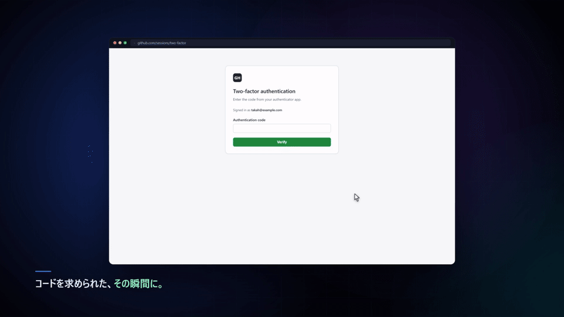
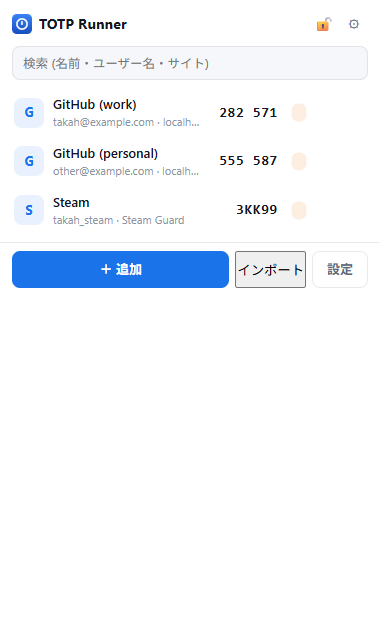
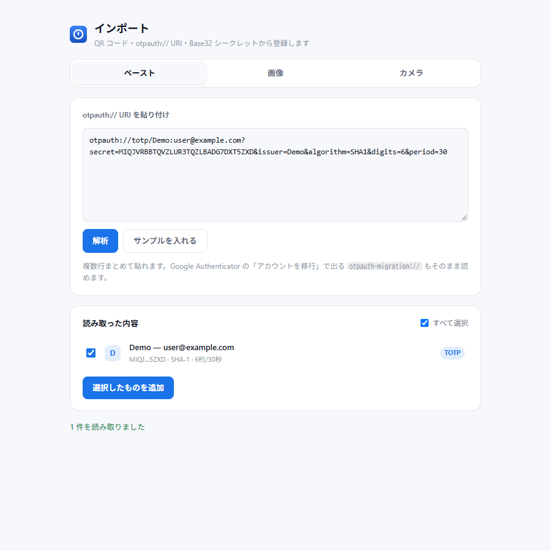

# TOTP Runner

**2 要素認証のコードを、入力欄に。**

TOTP の入力欄を検知して、登録したアカウントのコードをその場で提案・自動入力する Chrome 拡張機能です。
常時 UI は出ません。入力欄にフォーカスした瞬間だけ、候補が小さく現れます。

[English README is here](README.en.md)

---

▶ **[フルサイズのデモ動画（MP4 / 35 秒）](docs/demo.mp4)**

  
  

---

## これで変わること

**入力欄にフォーカスすると、候補が出る。**
認証アプリを開いて、コードを探して、戻って入力する——その往復がなくなります。
`autocomplete="one-time-code"`、ラベルの文言、桁数などから TOTP の入力欄を見分けます。1 桁ずつ入力する 6 分割の欄にも対応しています。

**アカウントを間違えない。**
同じサービスに複数のアカウントを登録していても、ログイン中のユーザー名やそのサイトでの利用履歴から、使うべきものを上に並べます。

**ワンクリックで入力。**
候補をクリックするか `Enter` を押すだけ。ログインの送信はしません。

---

## インストール

所要時間は 1 分ほどです。プログラミングの知識は要りません。

### 1. ファイルをダウンロードする

[Releases](../../releases) を開き、最新版の **`totp-runner-x.y.z.zip`** をダウンロードして、**展開（解凍）** します。

`manifest.json` というファイルが入ったフォルダが出てきます。このフォルダを後で使います。

### 2. Chrome に読み込む

1. Chrome のアドレスバーに `chrome://extensions/` と入力して開く
2. 画面右上の **デベロッパー モード** をオンにする
3. 左上の **パッケージ化されていない拡張機能を読み込む** を押す
4. 手順 1 で展開したフォルダ（`manifest.json` があるフォルダ）を選ぶ

### 3. ピン留めする

ツールバー右上のパズルのピースのアイコンを押し、**TOTP Runner** の横にあるピンのアイコンを押します。
これでアイコンからいつでもコードを確認できます。

> Chrome ウェブストアでは配布していません。手元に読み込む形式のため、更新は新しい ZIP を入れて「再読み込み」を押す形になります。

---

## 使い方

### アカウントを登録する

ツールバーのアイコンをクリックし、**＋ 追加** を押します。

| 項目 | 入れるもの |
|---|---|
| 種類 | ふつうは TOTP。Steam のコードなら Steam Guard |
| ラベル | 一覧に出る名前（例: GitHub (仕事用)） |
| ユーザー名 / メール | そのサービスのログイン ID。複数のアカウントを使い分けるなら必ず入れてください |
| シークレット | 認証アプリの設定画面に出る Base32 のキー |
| 紐付けるサイト | そのコードを使うサイトのドメイン（例: `github.com`）|

**＋ 現在のタブのサイトを追加** を押すと、いま開いているサイトのドメインが自動で入ります。

QR コードや `otpauth://` からまとめて登録したいときは、**インポート** を押してください。

### サイトでコードを使う

対象のサイトで TOTP の入力欄をクリックすると、候補が出ます。
クリックするか、`Enter` を押すと入力されます。

初めてそのサイトを使うときは「このサイトは未登録」と表示されます。ポップアップからサイトを紐付けてください。
**登録していないサイトでは、アカウント名もコードも一切表示されません。**

### ショートカット

| キー | 動作 |
|---|---|
| `Alt+Shift+T` | コード一覧を開く |
| `Alt+Shift+L` | ページ上でコードを検索する |
| `↑` `↓` `Enter` `Esc` | 候補の選択・決定・閉じる |

キーの割り当ては `chrome://extensions/shortcuts` で変更できます。

---

## できること

### 入力

- TOTP の入力欄を自動で見分けて、候補をその場に表示
- 1 桁ずつ入力する 6 分割の欄にも、1 文字ずつ自動入力
- コードの残り時間をリングで表示。残り 5 秒を切ると色が変わります
- 6 / 7 / 8 桁、SHA-1 / SHA-256 / SHA-512、周期が 30 秒以外のサイトにも対応
- **Steam Guard** の 5 文字コードに対応

### アカウントの並び順

- そのサイトに紐付けたアカウントを優先
- 前回そのサイトで使ったアカウントを記憶して、次回から上に表示
- ログイン中のユーザー名と一致するアカウントを優先
- `t***@example.com` のような伏せ字のメールアドレスとも照合

### 登録・バックアップ

- QR コードの読み取り（画像・カメラ）
- `otpauth://` の貼り付け
- **Google Authenticator からの移行データをそのまま読み込み**
- パスフレーズで暗号化したバックアップの書き出し・読み込み
- 同じシークレットの二重登録を防ぐチェック

### 安心して使うための機能

- パスフレーズによる暗号化と、一定時間でのかぎの自動ロック
- サイトごとに「ここでは出さない」を指定できる除外リスト
- コードを伏せ字にする表示モード
- 通知（同じ通知を更新するので、画面に溜まりません）

---

## 安全面について

**登録したシークレットが、見ているページに渡ることはありません。**
コードを作る処理は拡張機能の中だけで完結し、ページ側には 6 桁のコードしか渡りません。

**コードはサイトごとに固定されます。**
`github.com` に紐付けたアカウントは、`github.com.evil.tld` のような似せたドメインでは**候補にもコードにも出ません**。偽のログイン画面を開いても、拡張機能は何も表示しません。

**外部と通信しません。**
入力した内容がどこかに送られることはありません。テレメトリもありません。データはお使いの Chrome の中だけに保存されます。

パスフレーズを設定すると、保存されたシークレットは暗号化されます。ブラウザを閉じたとき、一定時間操作しなかったとき、手動でロックしたときに復号のかぎが消えます。

> **注意**: パスフレーズを設定しない場合、シークレットは暗号化されずに保存されます。共用の PC で使う場合や、重要なアカウントを使う場合は、設定画面からロックを有効にすることをおすすめします。

---

## 対応環境

| 項目 | 内容 |
|---|---|
| ブラウザ | Google Chrome 116 以上（パソコン版） |
| OS | Windows / macOS / Linux / ChromeOS |
| インストール作業 | フォルダを読み込むだけ（ビルドや追加ソフトは不要） |
| ネットワーク | 不要。オフラインでも動きます |
| 保存先 | お使いの Chrome の中のみ |

Chromium 系（Edge / Brave など）でも動く見込みですが、動作確認とサポートの対象は Chrome です。
会社の PC で「未承認の拡張機能」が禁止されている場合は読み込めません。

---

## よくある質問

**Q. コードが一致しない**
パソコンの時刻がずれている可能性があります。OS の時刻同期を有効にしてください。TOTP は 30 秒単位なので、数秒のずれでも失敗します。
サイトが 8 桁や SHA-256 を使っている場合は、アカウントの「詳細設定」で桁数とアルゴリズムを合わせてください。

**Q. 候補が出ない**
そのサイトが未登録か、除外リストに入っています。ポップアップからサイトを紐付けてください。
パスワード欄や、ふつうの検索欄では候補を出しません。

**Q. 「パッケージ化されていない拡張機能を読み込む」が見つからない**
`chrome://extensions/` の右上にある「デベロッパー モード」をオンにしてください。

**Q. スマホでも使える？**
使えません。パソコン版 Chrome の拡張機能です。

**Q. データはどこかに送信される？**
されません。外部と通信する仕組みを持っていません。

**Q. サイトを追加するたびに設定が必要？**
初回だけです。一度使うと、そのサイトで選んだアカウントを覚えます。

**Q. 拡張機能を消したらデータはどうなる？**
Chrome の中に保存されているデータも削除されます。必要なら、先にバックアップを書き出してください。

---

## ライセンス

[MIT](LICENSE)

本ソフトウェアは無保証です。大切なアカウントに使う場合は、バックアップとロック設定を行ったうえでご利用ください。
